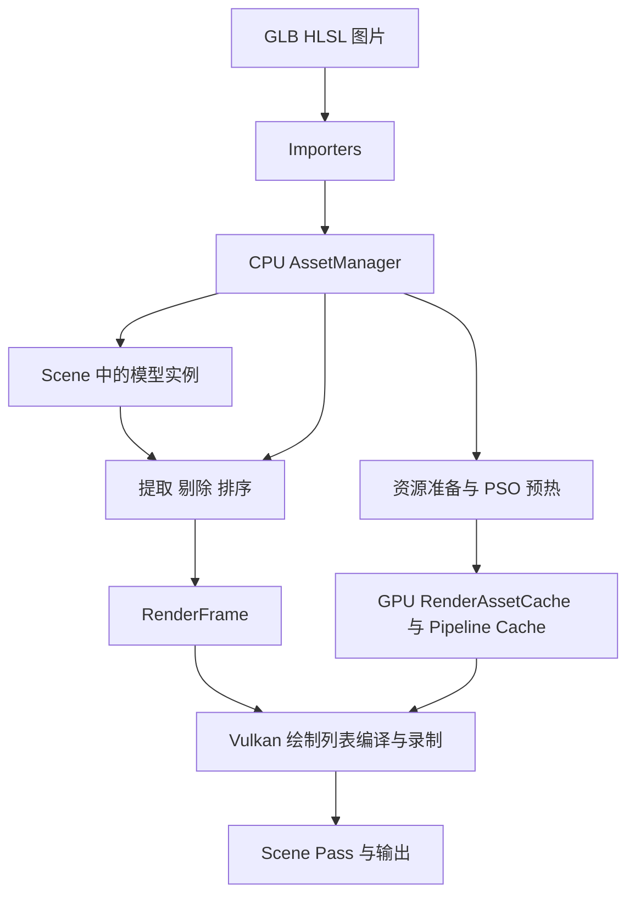
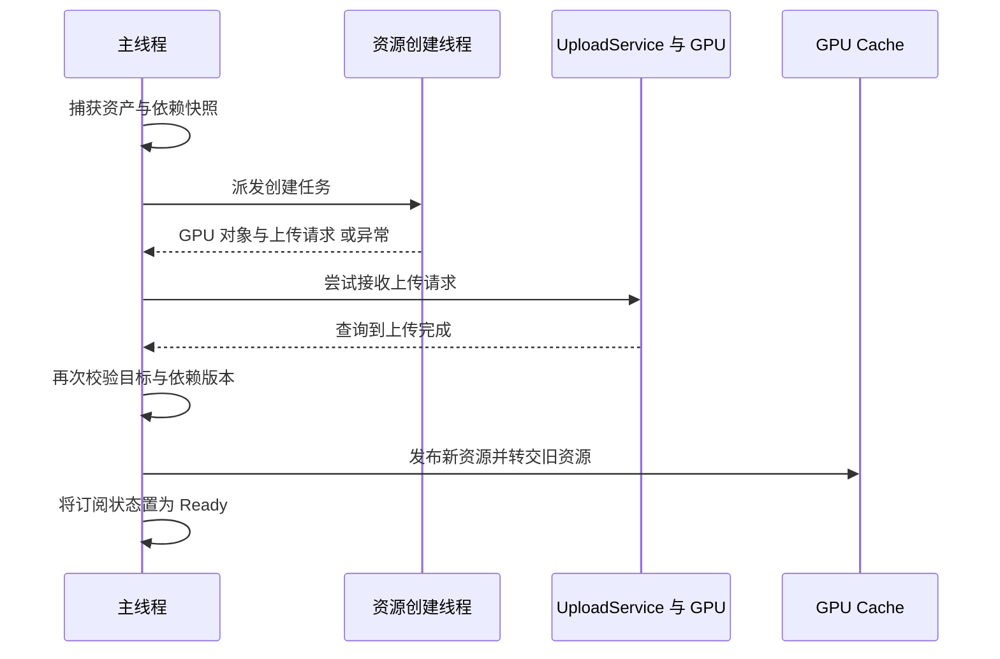

# RubiaEngine 一下午复习指南

这次复习的目标，是恢复你对自己引擎的掌控感：一个文件怎样变成屏幕上的物体，一帧怎样组织，异步准备怎样保证版本正确，GPU 仍在使用的旧资源怎样释放。下午结束时，应该能沿代码讲清这四条链路，并知道下一次改功能应从哪里进入。

按约 4 小时安排，包含两次休息。先看数据结构和调用关系，再钻实现；遇到大文件只读指定函数。暂时不用重新学习所有 Vulkan 初始化细节，也不用从第一条提交开始重放历史。

基线：2026 年 10 月 20 日的本地 `dev` 工作区，提交 `3de6496`。本地还包含未提交的 macOS DXC 支持、导入缓存时间戳修复和展厅启动脚本。当天 Debug 增量构建成功，已注册 CTest 4/4 通过；GPU 测试注册关闭，因此这次结果不包含 GPU 回归。

## 下午安排

假设 13:30 开始；实际开始时间可以整体平移。

| 时间 | 用时 | 内容 | 完成标志 |
| --- | --- | --- | --- |
| 13:30–13:50 | 20 分钟 | 仓库地图与启动主循环 | 能画出 App、CPU 前端和 Vulkan 后端的关系 |
| 13:50–14:25 | 35 分钟 | 资产、场景、Shader 与材质 | 能解释 identity、revision、snapshot 各解决什么问题 |
| 14:25–15:00 | 35 分钟 | 从 Scene 到一次 Draw | 能追踪一个 submesh 怎样进入透明或不透明绘制列表 |
| 15:00–15:10 | 10 分钟 | 休息 | 离开屏幕 |
| 15:10–15:55 | 45 分钟 | 异步资源准备与 PSO 预热 | 能区分 CPU 完成、资源 Ready、Pipeline Ready |
| 15:55–16:25 | 30 分钟 | 上传、版本替换与资源退休 | 能解释为什么替换缓存后还不能立即析构旧资源 |
| 16:25–16:35 | 10 分钟 | 休息 | 离开屏幕 |
| 16:35–17:10 | 35 分钟 | 编辑器与展厅动手验证 | 完成至少两个观察实验，知道测试入口 |
| 17:10–17:30 | 20 分钟 | 闭卷自测与下一步选择 | 写下完整链路和一个有验收标准的小任务 |

每节最后有一道检查题。超过预计时间时，先保住主链路，把“深入阅读”留到以后。最后一节附参考答案，先自己回答再对照。

## 第一节 仓库地图与启动主循环

### 当前引擎到了哪里

上次开发重点是把“能画模型”推进到“能在编辑器里增量导入、准备和替换资源”。当前已有资产注册与版本、CPU 场景、材质反射、渲染列表、Vulkan 后端、异步资源与 PSO 准备、编辑器资产操作，以及材质展厅。

最近一次明确的绘制功能提交是 `8251736` 的 MSAA：当前场景路径要求 4× MSAA，设备或附件格式不支持时会报错。`3de6496` 是合并提交。主要功能脉络可读 [CHANGELOG](CHANGELOG.md) 的 0.23–0.25 节，不必通读全部历史。

### 模块地图

| 目录 | 负责什么 | 先记住的边界 |
| --- | --- | --- |
| `engine/asset` | CPU 资产、句柄、版本、快照、Shader 接口与材质模板 | 资产存在不表示 GPU 上已有可用资源 |
| `engine/scene` | 运行时场景节点、层级和模型实例 | SceneNode 引用 Model，实例变换和材质覆盖属于场景 |
| `engine/render` | 相机、场景提取、剔除、排序、准备接口 | RenderFrame 可以在 CPU 上构建；接口不暴露 Vulkan 对象 |
| `importers` | GLB/glTF、图片/KTX、HLSL/SPIR-V 导入与反射 | 将外部格式转成引擎资产 |
| `renderer/vulkan` | GPU 资源、上传、Pipeline、命令录制、帧同步 | 消费具体资源与绘制数据，Model 的展开留在 CPU 前端 |
| `apps/editor` | 窗口应用、主循环、编辑器界面、内容工作流 | 组合资产、场景、准备接口与 Renderer；App 本身仍依赖 Vulkan |
| `tests` | CPU 单测、应用与 GPU 回归、展厅装配 | 用测试理解功能的成功、取消和失败契约 |
| `Assets` | 模型、Shader、贴图、字体和展厅 | 当前仓库目录名是大写 `Assets`，注意旧说明中的小写路径 |



这里有两条会合的路径：**场景每帧生成绘制意图；准备系统提前生成可供后端使用的 GPU 资源。** CPU 前端不应为了生成一个 RenderItem 而创建 VkBuffer。

### 只读这三个入口

1. [main.cpp](apps/editor/main.cpp)：区分普通启动、`--editor`、展厅和测试参数。
2. [EditorApp.cpp](apps/editor/EditorApp.cpp)：看 `makeRunConfig()`，确认编辑器设置 `initializeEmptyScene = true` 与 Editor 输出模式。
3. [App.cpp](apps/editor/App.cpp)：看 `run()`、`initVulkan()`、`mainLoop()`、`cleanup()`。

主循环可压缩为：

```text
处理窗口事件与 resize
→ resourcePreparation_.advance()
→ updateContentLoading()
→ processPendingTextureReimport()
→ gui.update() 推进编辑器业务
→ GUI begin / draw / end
→ sceneReady ? render(RenderFrame) : renderGui()
```

`advance()` 即使没有加载任务也要每帧执行，它承担共享上传和准备结果发布。GUI 的 `update()` 推进业务，`draw()` 组织当帧界面；从界面触发导入后，操作通常由后续 update 处理。

普通启动不自动加载 Demo。编辑器会准备内置资源和空场景，所以“没有导入模型”和“Renderer 没有任何场景渲染基础设施”是两个不同状态。

**检查题：** 为什么 `sceneReady()` 为 false 时，窗口仍然能显示 GUI？

## 第二节 资产 场景 Shader 与材质

### 先分清五个名词

| 名词 | 表示什么 | 举例 |
| --- | --- | --- |
| MeshAsset | CPU 顶点、索引、submesh 和局部包围盒 | 一个可包含多个绘制范围的网格 |
| ModelAsset | 可复用的模型内部节点层级，引用 Mesh | 同一个模型可以在场景中实例化多次 |
| SceneNode | 运行时实例、父子关系、局部变换和可选材质覆盖 | 两个节点引用同一 Model，位置与材质不同 |
| MaterialTemplateAsset | 从 Program 反射得到的参数和纹理槽规则 | 参数类型、偏移和 descriptor binding 的模式 |
| MaterialAsset | 某份模板下的具体参数、纹理引用与渲染状态 | 红色、粗糙度 0.6、绑定某张贴图 |

阅读顺序：[MeshAsset.hpp](engine/asset/MeshAsset.hpp) → [ModelAsset.hpp](engine/asset/ModelAsset.hpp) → [Scene.hpp](engine/scene/Scene.hpp)。先看字段，不用逐行读验证逻辑。

当前 GPU 顶点存储统一使用 `asset::Vertex`。它包含 position、normal、UV、tangent、color 等字段；有 boneIds / boneWeights 字段也不能据此推断已经完成动画与蒙皮渲染。模型层级、网格存储和动画能力要分别判断。

### 身份与内容版本

看 [资产说明](engine/asset/README.md) 的“资产身份与内容版本”，再扫 [AssetHandle.hpp](engine/asset/AssetHandle.hpp) 和 [AssetSnapshot.hpp](engine/asset/AssetSnapshot.hpp)。

- **index**：注册表中的槽位。
- **generation**：区分同一槽位先后装过的资产，防止删除后旧句柄误指新对象。
- **contentRevision**：同一个资产身份下，内容发布过多少次；替换内容通常保留 handle，增加 revision。
- **domain**：区分不同 AssetManager，两个管理器可以出现数值相同的 handle。
- **snapshot**：固定一次不可变 CPU 内容及依赖，给跨帧和后台准备使用。

例子：纹理 T 的 handle 不变，内容从 revision 3 更新到 4。场景和材质仍能引用 T；后台拿到 revision 3 快照的任务继续持有旧数据，但发布时必须服从目标及依赖版本校验。若删除 T 再复用槽位，generation 负责让旧 handle 失效。

快照保证捕获内容的生命周期与不可变性，AssetManager 自身的并发读写仍需要遵守线程边界。不要把“拿到了 snapshot”扩大理解成“整个注册表可以多线程随意修改”。

### Shader 到 Material 的依赖

```text
HLSL → DXC → SPIR-V → SpirvReflection → ShaderAsset
ShaderAsset 的 VS / PS 组合 → ShaderProgramAsset
Program 反射接口 → MaterialTemplateBuilder → MaterialTemplateAsset
Template + 参数值 + 纹理引用 + 渲染状态 → MaterialAsset
```

ShaderProgram 负责阶段组合与接口兼容；模板负责把材质 descriptor set 转成可填写的参数模式；Material 保存实际数据。这样 GUI 不必为每个 Shader 手写 UBO offset。

当前常用绘制约定是 set 0 放 Camera/Object 数据，set 1 放材质资源，逐 Draw 索引和裁剪阈值通过 Push Constants 传递。自定义 HLSL 仍需遵守 Draw ABI、顶点输入和当前模板支持范围；“能编译成 SPIR-V”只完成了第一步。

必读：[MaterialTemplateBuilder.hpp](engine/asset/MaterialTemplateBuilder.hpp)、[RenderData.hpp](engine/render/RenderData.hpp)。深入阅读再看 [ShaderProgramAsset.cpp](engine/asset/ShaderProgramAsset.cpp) 的合并与校验。

**检查题：** 为什么更新 Texture 不需要改变引用它的 Material handle，却仍需要重新检查材质的 GPU 依赖？

## 第三节 从 Scene 到一次 Draw

### CPU 前端的四步

从很短的 [RenderFrameBuilder.cpp](engine/render/RenderFrameBuilder.cpp) 开始：

```text
Scene + AssetManager + RenderView
→ SceneRenderExtractor::extract → RenderCandidate[]
→ CullingSystem::cull → 可见候选索引
→ RenderListBuilder::build → 有序 RenderList + ObjectData
→ RenderFrame
```

1. **提取**：遍历 Scene 层级和引用的 Model 层级，合成世界变换；展开 Mesh 的 submesh。实例覆盖材质优先于 submesh 原材质，生成世界包围盒和候选项。
2. **剔除**：根据视图层掩码、包围盒与视锥等规则，决定哪些候选可见。
3. **分类和排序**：结合 MaterialRenderState 选择队列，生成 RenderItem。
4. **输出**：ObjectData 与 draw 的 objectIndex 对应；RenderFrame 携带视图和绘制列表。

阅读：[SceneRenderExtractor.cpp](engine/render/SceneRenderExtractor.cpp) 的 `extract()` → [CullingSystem.cpp](engine/render/CullingSystem.cpp) 的 `cull()` → [RenderListBuilder.cpp](engine/render/RenderListBuilder.cpp) 的 `build()`。

排序重点见 [RenderItemComparator.hpp](engine/render/RenderItemComparator.hpp)：不透明项先按队列、粗粒度近到远深度桶，再聚合同类 Pipeline / 材质 / Mesh 状态；透明项在队列内优先远到近，深度相同时才继续比较状态。不透明列表也容纳 AlphaClip 项，通过 queue 区分。

透明排序使用物体包围盒中心的视图深度，不能自动解决相交透明物体或每像素多层混合的所有问题。

### 后端的两步

[VulkanDrawListCompiler.cpp](renderer/vulkan/VulkanDrawListCompiler.cpp) 将前端 handle 和绘制元数据解析成驻留 GPU Mesh、Material 和匹配的 Pipeline；[VulkanDrawListRecorder.cpp](renderer/vulkan/VulkanDrawListRecorder.cpp) 将这些结果录入命令缓冲。

Recorder 的阅读重点：

```text
Pipeline 变化 → bind Pipeline，并重新建立 frame descriptor 与动态状态
Mesh 变化 → bind vertex / index buffer
Material descriptor 变化 → bind set 1
每次 Draw → push objectIndex / alphaClipThreshold → draw 或 drawIndexed
```

前端 `PipelineVariantKey` 用于表达和排序前端状态，后端 `GraphicsPipelineKey` 描述当前支持的完整 PSO 创建内容。后者不能只凭一个哈希值判相等，实际比较编码后的字段。

### 一帧的 GPU 顺序

在 [VulkanRenderer.cpp](renderer/vulkan/VulkanRenderer.cpp) 只定位 `renderFrame()` 与 `recordCommandBuffer()`：

```text
编译绘制列表
→ 等待当前 frame slot fence → 重置该槽命令并回收该槽退休资源
→ acquire swapchain image → 确认该 image 可复用
→ 更新 Camera/Object 帧数据 → 录制命令
→ reset fence → queue submit → 关联待退休资源
→ present → 切换 frame slot
```

frame slot 是 CPU 管理的在途帧资源槽；imageIndex 是这次拿到的交换链图像。两者数量和复用节奏可以不同，不能互换使用。

有场景时，先执行带深度的 4× MSAA Scene Pass 并 resolve，再转换为可采样状态。Runtime 通过 Present Pass 输出；Editor 先生成视口输出，再由 GUI 显示。没有场景时可直接走 GUI 输出路径。

**检查题：** 同一个 Model 实例化两次时，哪些 CPU/GPU 数据可共享，哪些每个实例不同？

## 第四节 异步资源准备与 PSO 预热

这是本次复习最值得多花时间的部分。先读接口与调用方，再读内部调度，避免直接陷进大状态机。

### 先建立三个完成点

| 完成点 | 此时保证什么 | 此时还不能推断什么 |
| --- | --- | --- |
| CPU 导入完成 | 外部文件已解析或编译，CPU 内容可用于注册和准备 | 不能推断已经上传或可以绘制 |
| Resource Ready | 请求快照及依赖已完成必要创建与上传，并发布到 GPU cache | 不能推断特定 Scene Pass 下的 PSO 已预热 |
| Pipeline Ready | 请求的驻留材质变体在当前目标场景 pass 下完成 PSO 准备 | 不会自动往 Scene 添加节点或赋予实例材质 |

业务方最后才插入节点或切换实例覆盖。这能避免把尚未准备好的内容提前暴露给渲染。

### 接口与调用方

依次读 [ResourcePreparation.hpp](engine/render/ResourcePreparation.hpp)、[ResourcePreparationTypes.hpp](engine/render/ResourcePreparationTypes.hpp)，然后读 [EditorAssetController.cpp](apps/editor/content/EditorAssetController.cpp) 的 `update()`。

Controller 的工作流程：

```text
接收 GUI 命令 → 后台 CPU 导入 → 主线程注册资产
→ 每帧限量提交资源根请求
→ 等全部 Resource Ready
→ prewarmPipelines → 等 Pipeline Ready
→ job.publish 插入节点或切换材质 → release tickets
```

目前 Controller 每次 update 最多接收四个根资源请求；遇到 QueueFull 留到后续帧重试。它通过 `render::ResourcePreparation` 操作，不直接创建 Vulkan 对象。

### 任务和订阅分开理解

| 返回 disposition | 含义 | 调用方责任 |
| --- | --- | --- |
| Started | 新建实际准备工作 | 保存自己的 ticket，查询并在结束后 release |
| Shared | 复用同版本的在途工作 | 仍拥有独立 ticket；取消只影响自己的订阅 |
| CacheHit | 对应版本及依赖已经驻留 | 仍获得独立 ticket，仍需 release |

两个调用方准备同一快照，可以共享一个实际任务，但不能用同一个 ticket 表达两个独立取消意图。最后一个等待订阅取消才会触发底层工作的相应取消；已提交 GPU copy 仍须保活到完成。

`release(ticket)` 回收订阅记录，不表示从 GPU cache 驱逐资源。`QueueFull` 表示当前不能接收请求，调用方应保留输入后重试。

### 三种后台工作

| 执行位置 | 工作内容 | 关键限制 |
| --- | --- | --- |
| CPU 导入异步任务 | 扫目录、文件读取、GLB 解析、图片解码、DXC 与反射 | 最终共享 AssetManager 注册与业务发布回到主线程 |
| Resource 创建线程 | 根据固定输入和依赖创建 GPU 对象，构建上传请求 | 不读取正在变化的实时 cache |
| Pipeline 创建线程 | 创建原生 GraphicsPipeline | 使用值拥有的输入，结果回到渲染线程发布 |

它们是各自的工作机制，当前没有统一的通用 Job System。上传服务的 tick、Vulkan 队列提交与准备发布仍由主线程调度。



没有 transfer 的资源可以跳过上传阶段，但仍经过准备和发布。`Preparing` 包括等待依赖、等待创建、等待上传接收或发布，并不说明任务还没开始。

### 内部实现只追一条成功路径

1. [VulkanResourcePreparationBridge.cpp](renderer/vulkan/VulkanResourcePreparationBridge.cpp)：前端接口怎样绑定 Renderer 与 cache，会话怎样追踪 ticket。
2. [VulkanResourcePreparation.cpp](renderer/vulkan/VulkanResourcePreparation.cpp)：看 `prepare()`、`advanceDependencies()`、`advanceCreation()`、`advance()`。
3. [ResourcePreparations.cpp](renderer/vulkan/ResourcePreparations.cpp)：选择一种资源，追它的依赖捕获、创建、上传构造与 publish。
4. [VulkanPipelinePreparation.cpp](renderer/vulkan/VulkanPipelinePreparation.cpp)：再看 Pipeline worker 怎样与主线程交接。

Model 先由 CPU 的 `collectModelMeshes()` 展开去重，后端准备具体 Mesh 等资源；不要在后端寻找一个拥有整个 Model 层级的 GPU 对象。

**检查题：** A、B 同时请求同版本纹理，A 取消、B 继续。应该取消哪个订阅？纹理成功驻留后，B 的 release 应不应该销毁纹理？

## 第五节 上传 版本替换与资源退休

### UploadService 与 Preparation 各管一层

Preparation 知道资产版本、依赖和发布语义；UploadService 接收 Buffer/Image 操作，按预算组织上传批次，管理 staging、命令与在途目标的生命周期。一个 preparation 可以没有上传，也可以依赖多个资源的准备。

读 [VulkanUploadService.cpp](renderer/vulkan/VulkanUploadService.cpp) 的 `tryEnqueue()`、`tick()`、`finishBatch()`；再扫 [TextureUploadBuilder.hpp](renderer/vulkan/TextureUploadBuilder.hpp) 和 [UploadContext.hpp](renderer/vulkan/UploadContext.hpp)。

Staging 让 CPU 源内容进入可供传输的内存，再复制到目标。请求取消不等于 GPU 执行过的命令可以撤销；已经提交的批次仍需等 fence，才能回收 staging 和目标引用。

### 为什么发布前还要校验版本

假设任务为 Texture revision 3 开始创建，期间用户发起 revision 4。如果只判断“GPU copy 成功”，旧任务可能覆盖更新的内容。因此准备层在依赖推进、创建完成和最终发布等位置检查目标及依赖，拒绝过期发布。

依赖版本也很关键：Material 自身参数没变，但 Texture 更新后，材质的 GPU descriptor 需要指向新纹理。版本缓存不能只比较 Material 自己的 revision。

### 旧资源的释放时机

CPU cache 已切换新资源时，GPU 可能还在执行引用旧资源的上一帧。RAII 负责对象析构时的释放动作，帧同步负责决定何时允许发生这个析构。

```text
发布新资源 → 旧资源放入 pendingRetired_
→ 下一次成功 queue submit 后，转入该 frame slot 的 retired
→ 再次复用该 slot，等待这次提交的 fence
→ 重置旧命令并清理该槽 retired
```

不能在等完当前槽“上一次提交”的 fence 后，立即清空刚加入的 pendingRetired_：其他在途槽可能还在使用这些资源。当前实现中，相关渲染与上传使用同一 graphics queue，且发布不与命令录制交错；后续成功提交及其 fence 提供安全的回收边界。

如果 acquire 提前返回或提交前出错，pendingRetired_ 必须继续保留，不能绑定到一次没有成功发生的提交。关闭、resize、整体 cache reset 也要遵守 GPU 完成与销毁顺序。

读 [RetiredResources.hpp](renderer/vulkan/RetiredResources.hpp)，回到 `VulkanRenderer::renderFrame()` 对照顺序。[资源退休说明](renderer/vulkan/RESOURCE_RETIREMENT.md) 的所有权与提交章节适合辅助理解；其中“文件重导入仍同步等待”的旧段落已落后于当前实现，应以 AppTextureReimport 与准备发布事务代码为准。

### 纹理重导入的完整事务

当前 [AppTextureReimport.cpp](apps/editor/AppTextureReimport.cpp) 将磁盘、CPU 资产和 GPU 发布组合起来：

```text
后台 cook 临时 KTX2 与候选 TextureAsset
→ 主线程校验基准版本并预留新 revision
→ 通过统一 Preparation 准备候选快照
→ 上传完成后 transaction.begin 安装文件并保留回滚条件
→ GPU cache publish
→ transaction.commit 交换 CPU 内容并确认文件提交
```

begin 或 GPU 发布失败时 rollback，保住原有内容。事务回调在主线程发布边界运行；它保证运行过程中的提交和失败处理，不提供跨进程崩溃恢复日志。

纹理替换为受影响材质创建新的 descriptor，旧纹理与旧绑定延迟释放；未改变的材质参数 buffer 可以共享，纹理内容变化通常也不需要创建新 PSO。

**检查题：** 为什么“新纹理上传完成”仍然不是“旧纹理可以马上销毁”的充分条件？

## 第六节 编辑器与展厅动手验证

### 先复现基础检查

在仓库根目录执行：

```bash
cmake --build build/debug -j 4
ctest --test-dir build/debug --output-on-failure
```

已有 `build/debug` 配置时直接使用。当前配置启用了 BUILD_TESTING，关闭了 RUBIA_ENABLE_GPU_TESTS。若从零配置，需要 CMake、Ninja、Vulkan SDK、vcpkg 及工程依赖；[CMakePresets.json](CMakePresets.json) 读取 `VCPKG_ROOT`。本次复习先使用现有配置即可。

| 当前注册的测试 | 主要用途 |
| --- | --- |
| asset-revision-test | 身份、内容版本、快照及替换行为 |
| editor-theme-test | 编辑器主题 |
| shader-program-test | Program 接口和材质模板规则 |
| asset-smoke-test | 真实资产导入相关回归 |

`asset-smoke-test` 入口还串接了多项 CPU 检查，可以从 [AppSmokeTests.cpp](tests/AppSmokeTests.cpp) 的 `runAssetImportTest()` 往下追。GPU 测试的注册条件和命令见 [tests/CMakeLists.txt](tests/CMakeLists.txt)。旧 CHANGELOG 中的 9/9 是当时 RTX 4070 环境的结果，与本机这次 4/4 分开看。

### 打开现有展厅

macOS 在仓库根目录：

```bash
bash Assets/preparation_gallery/run.sh
```

脚本会先构建 VulkanApp，再切换到正确工作目录启动。需要 Vulkan 运行环境与可用的 DXC。当前未提交的 HlslShaderCompiler 已补充 POSIX/macOS 子进程路径，所以旧资产说明中“DXC 仅 Windows”不适用于这个工作区。

只打开空编辑器：

```bash
cd build/debug/apps/editor
./VulkanApp --editor
```

展厅说明见 [Assets/preparation_gallery/README.md](Assets/preparation_gallery/README.md)。40 个测试几何体加合并建筑，覆盖多种 Shader 组合、贴图、AlphaClip、透明和双面状态。它展示了 GGX 等材质近似；玻璃没有折射，环境填充与接触暗部不代表完整 IBL 或阴影贴图。

### 三个观察实验

**实验一：共享模型与独立实例。** 在空编辑器 Assets 面板打开模型目录，把同一 GLB/glTF 拖入 Hierarchy 两次，分别修改位置。观察 Model 与 Mesh 可复用，SceneNode 独立。给其中一个实例覆盖材质，再确认另一个保持原有表现。操作入口可追 `enqueueModel()`、`assignMaterial()` 与 SceneNode 的 `materialOverride`。

**实验二：材质值与 Pipeline 状态。** 在展厅中比较 05/06：它们 AlphaClip 阈值不同，设计上共享裁剪 PSO。比较 02/03：PS 相同但 VS 不同，形成不同 Pipeline 组合。比较普通实体与 09 双面材质：剔除状态也影响 PSO。无需临时写性能统计代码，先用展厅矩阵与 `GraphicsPipelineKey` 对照解释原因。

**实验三：追踪一次失败。** 在空编辑器从临时目录导入一个有语法错误的 HLSL，设置相应阶段与入口，观察错误和现有场景。然后读 `EditorAssetController::update()` 的 catch 与 `release()` 路径，区分“失败保留可用场景”与“回滚所有已注册 CPU 资产”；当前工作流不保证整套导入的数据库式回滚。用临时副本做实验，避免改展厅原文件。

如果 GPU 环境暂时无法启动，改做代码练习：在 `tests/EditorAssetImportTests.cpp` 找到导入失败用例，在 `tests/PreparationGallery.cpp` 找到 CacheHit、取消订阅和纹理替换验证，再用文字预测结果。不要为了复习顺手改造平台层。

## 第七节 闭卷自测与参考答案

### 先完成这张清单

- [ ] 不看代码画出文件 → CPU 资产 → 资源准备 → PSO → SceneNode → RenderFrame → Draw 的关系。
- [ ] 分别用一句话解释 handle、generation、revision、domain、snapshot。
- [ ] 解释 Model 与 SceneNode 的区别，以及 materialOverride 在哪里生效。
- [ ] 写出主循环里 advance、update、GUI、render 的顺序。
- [ ] 解释为何资源准备和 Pipeline 准备分成两阶段。
- [ ] 解释 Shared 订阅的取消与 release。
- [ ] 区分 frameIndex 和 imageIndex。
- [ ] 解释 Texture 更新为何可能换 descriptor 而不换 UBO 与 PSO。
- [ ] 画出旧资源从 cache 到 retired 再析构的顺序。
- [ ] 指出一个当前尚未实现的能力，并找到它应接入的位置。

### 每节检查题答案

1. **没有就绪场景为什么仍有 GUI？** `createPresentation()` 先创建基础呈现资源；`renderGui()` 可以独立输出界面，场景资源和场景 Pipeline 的就绪另行管理。
2. **Texture 更新为何要检查材质依赖？** 引用 handle 表示身份，revision 表示具体内容。材质身份可以保留，但驻留绑定需要跟随纹理的新版本；只比较 Material 自身版本会漏掉依赖变化。
3. **模型实例共享什么？** 可共享 Model、Mesh、原材质及对应驻留 GPU 对象。SceneNode 的实例变换、覆盖材质选择不同，提取后各 draw 的 ObjectData 与 objectIndex 也各自生成；覆盖材质相同的实例仍可共享该材质资源。
4. **A 取消 B 继续如何处理？** 取消 A 的订阅，保留 B 所需的共享任务。B 最后 release 只释放自己的 ticket，驻留纹理仍由 cache 管理。
5. **上传完成为何不能销毁旧纹理？** 上传 fence 解决新内容传输完成；旧纹理可能仍被之前提交的 draw 或 GUI descriptor 使用，要等覆盖这些使用的渲染完成边界。

### 五个故障定位题

| 现象 | 第一轮查看位置 | 先确认什么 |
| --- | --- | --- |
| 导入成功但物体不出现 | Controller job、资源/PSO 状态、Hierarchy、Culling | 是否完成两阶段准备并插入节点，是否被剔除或镜头没对准 |
| 切换 Shader 后校验失败 | SpirvReflection、ShaderProgram、MaterialTemplateBuilder | 阶段接口、descriptor、Push Constants 与顶点输入是否兼容 |
| 更新贴图后偶发崩溃 | 发布版本、descriptor 替换、退休容器 | 是否有旧对象提前释放或旧任务过期发布 |
| 首次绘制卡顿 | PipelinePreparation、DrawListCompiler、PipelineCache | 是否预热正确变体，是否触发同步绘制兜底创建 |
| resize 后导入状态丢失 | AppResize、GUI bridge、EditorLayer 生命周期 | 是否误把渲染桥重建扩大成编辑器业务 detach |

这些是排查起点，需要结合日志和状态确认原因，不能直接把现象等同于结论。

## 复习后的下一步

当前适合继续推进的边界包括场景与材质持久化、自动文件监听、逐 submesh 编辑、多种 GPU 顶点布局、更完整的光照与阴影。不要在复习当天同时开启几条主线。

建议用下面的格式写一个任务，选自己最想解决的一项：

```text
我要改善的使用场景：
用户能观察到的结果：
涉及的入口与模块：
需要保持的资源与线程契约：
最小验收方式：
暂不包含的扩展：
```

如果只是想找回开发手感，可以先考虑 Frame Selected：选择一个实例后按它的边界取景，复用已有 Frame Scene 的相机调整思路。验收是包含大背景平面的展厅中仍能对准选中物体，并正确处理无选择或无有效边界；它能串起选择、场景层级、包围盒与相机，不必先改异步准备核心。

## 后续查阅索引

| 想回答的问题 | 阅读入口 |
| --- | --- |
| 最近为什么拆出这么多资源准备类 | [CHANGELOG](CHANGELOG.md) 的 0.19–0.25 |
| 启动、加载、异步线程的完整约定 | [编辑器内容工作流](apps/editor/content/README.md) |
| Shader 反射怎样变成材质字段 | [资产说明](engine/asset/README.md) 与 MaterialTemplateBuilder |
| 准备请求的状态与所有权 | [ResourcePreparation.hpp](engine/render/ResourcePreparation.hpp) |
| 一个场景如何变成可绘制项 | [RenderFrameBuilder.cpp](engine/render/RenderFrameBuilder.cpp) |
| Pipeline 的真正匹配条件 | [GraphicsPipelineKey.cpp](renderer/vulkan/GraphicsPipelineKey.cpp) |
| 怎样证明准备、取消、更新没有破坏行为 | [AssetPreparationTests.cpp](tests/AssetPreparationTests.cpp)、[PipelinePreparationTests.cpp](tests/PipelinePreparationTests.cpp) |
| 纹理上传细节怎样验证 | [VulkanUploadTests.cpp](tests/VulkanUploadTests.cpp) |
| 展厅的材质矩阵与测试意图 | [展厅说明](Assets/preparation_gallery/README.md) 与 [PreparationGallery.cpp](tests/PreparationGallery.cpp) |
| 更深入的上传设计讨论 | [GPU_RESOURCE_UPLOAD_DESIGN.md](GPU_RESOURCE_UPLOAD_DESIGN.md)，结合当前实现阅读 |
