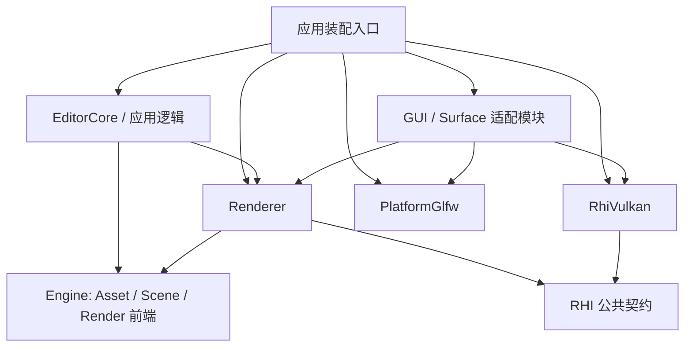

# RubiaEngine 渲染架构优化设计

日期：2026-11-04。状态：核心分层已实施；本文件同时保留设计依据、实际边界与验证记录。

本方案基于当前工作区代码。目标是把已有渲染能力分成职责清楚、可测试的模块，保持现有 Vulkan 画面与资源准备协议。首期只实现 Vulkan 后端，不承诺已经支持其他图形 API。

## 1. 设计结论

保留现有 Scene / Asset / Render 前端，在其下建立通用 Renderer 和窄 RHI，把 Vulkan 模块收敛为 GPU 执行实现。优先抽离材质到 Pipeline 的编译规则，再沿资源、绘制、Pass、应用接入逐步迁移。

成功标准：增加渲染 Pass、修改材质规则或资产准备策略时，通常只改 Renderer；调整 Vulkan 内存分配、描述符与同步实现时，通常只改后端。公共边界由构建目标约束，而不只由目录命名约束。

当前值得保留的基础：

- `engine/render` 已完成场景提取、裁剪、排序和 RenderFrame 构建。
- `ResourcePreparation`、`ApplicationGuiRenderBridge` 已提供应用侧窄接口。
- 资源准备已有不可变快照、版本/依赖校验、请求去重、共享订阅、取消和原子发布。
- GPU 资源已有成功提交后转交退休批次的机制；Pipeline 缓存已有内容键与所有权语义。

首期不引入完整 RenderGraph、第二套资产系统、插件化后端加载、多队列调度、bindless、异步命令录制或第二个真实后端；也不把同步 resize/readback 的优化绑进本次结构调整。

## 2. 重构前的问题与目标边界

| 重构前入口 | 混合的职责 | 拆分方向 |
| --- | --- | --- |
| `VulkanRenderer::recordCommandBuffer` | Pass 顺序、Editor/Runtime 策略、Vulkan 命令 | Renderer 决定流程；RHI 执行 |
| `VulkanDrawListCompiler::describePipeline` | 材质变体、Shader ABI、Vulkan 状态翻译 | MaterialPipelineCompiler + Vulkan Pipeline 创建器 |
| `DefaultPipelineFactory` | `asset::Vertex`、Draw 常量 ABI、Vk 描述 | ABI 与默认布局归 Renderer |
| `RenderAssetCache` | 资产版本、依赖、驻留对象、DescriptorPool | Renderer 保存资产语义，资源表示改持 RHI 引用 |
| `VulkanResourcePreparation` | 共享请求、worker、发布事务、GPU 创建 | Renderer 调度准备，通过 RHI 创建与上传 |
| `VulkanScenePreparation` | 资源根请求、预热、激活 | Renderer 的 ScenePreparationSession |
| `FrameDataResources` | Camera/Object 数据与 Vulkan Buffer/Descriptor | FrameBindings + RHI Buffer/BindingSet |
| `VulkanApplicationGuiRenderBridge` | 资产预览、GUI 注册、原生句柄、退休 | 独立 GUI 适配模块 |
| `Window` | GLFW 生命周期与 Vulkan surface | 平台窗口 + Vulkan/GLFW 接入适配 |

此外，`Camera.cpp` 的投影矩阵包含 Vulkan Y 翻转；`ShaderAsset` 保存 SPIR-V，反射接口包含 set/binding。仅移除 `Vk*` 类型无法消除这些约定。

## 3. 目标模块和依赖

以下箭头表示编译依赖；Vulkan 实现 RHI 接口，Renderer 不依赖 Vulkan 实现。



| 构建目标 | 允许依赖 | 对外职责 |
| --- | --- | --- |
| `Rubia::Engine` | glm、基础公共配置 | 保留现有 CPU 资产、场景与 Render 前端 |
| `Rubia::Rhi` | 标准库、基础公共配置 | 资源描述、强类型引用、命令与完成契约 |
| `Rubia::Renderer` | Engine、Rhi | 绘制编译、资产驻留、准备、帧与 Pass 策略 |
| `Rubia::RhiVulkan` | Rhi；私有 Vulkan、VMA | GPU 对象、命令、传输、同步和呈现实现 |
| `Rubia::PlatformGlfw` | GLFW | 窗口、输入、事件、尺寸 |
| `Rubia::ImGuiCore` | ImGui 核心源码 | GUI Context 与组件 |
| GUI/Surface 适配目标 | 上述必要接口、ImGui 的 GLFW/Vulkan backend | 平台和原生 GPU 接入 |
| `Rubia::EditorCore` | Engine、Renderer 公共服务、Importers、ImGuiCore | 面板、Inspector、编辑操作 |
| 应用 executable / bootstrap | EditorCore、Renderer、具体后端与适配器 | 选择 Vulkan，组装和销毁对象 |

`engine/render` 继续保存现有前端和应用服务协议，首期不再把 Engine 拆成多个库。Renderer 实现 `ResourcePreparation`；RHI 和 Vulkan 后端都不能反向依赖 Engine。

目标目录仅表达模块位置，不要求第一步整体搬迁：

```text
engine/render/                 # 现有前端、RenderFrame、应用服务协议
renderer/core/                 # Renderer、帧调度、FrameBindings
renderer/resources/            # 资产驻留、准备、发布、退休
renderer/pipeline/             # 材质编译、PipelineLibrary
renderer/passes/               # ScenePass、OutputPass、UI 接入点
rhi/include/rhi/               # 后端无关 API
rhi/vulkan/                    # 原有低层 Vulkan 实现逐步迁入
platform/glfw/                 # 窗口和输入
integrations/imgui/            # GUI Context / 平台 / GPU 适配
integrations/vulkan_glfw/      # instance extensions / surface 创建
apps/editor/                   # 编辑器业务及少量 bootstrap
```

原生访问只允许在 Vulkan 实现、其专用 interop 头、适配模块、bootstrap 和后端测试中出现。不要在通用 RHI 上添加人人可用的 `void* nativeHandle()`。Vulkan 专用 interop 目标可以公开 Vulkan 头，但不能经 Renderer/EditorCore 公共依赖传递。

## 4. Renderer 内部分工

这些是逻辑职责，可按规模合并实现，无需每项都增加一个继承体系。

| 组件 | 负责 | 输入 / 输出 |
| --- | --- | --- |
| `Renderer` | 对外会话、帧顺序、输出模式、错误和 resize 协调 | RenderFrame → 输出结果 |
| `RenderAssetStore` | Asset handle/domain/revision → 驻留版本，依赖与 publication | AssetSnapshot → MeshGeometry / MaterialBinding 等 |
| `ResourcePreparationService` | 去重、订阅、worker、依赖准备、发布事务 | 保持现有 ResourcePreparation ticket 协议 |
| `ScenePreparationSession` | 汇总根资源、预热、Ready/Activate/Cancel | 保持现有场景准备状态机 |
| `MaterialPipelineCompiler` | 材质变体、反射与 ABI 校验、默认顶点布局 | 驻留材质快照 + Pass 描述 → GraphicsPipelineDesc |
| `PipelineLibrary` | 设备作用域的完整内容键、缓存、预热和发布 | GraphicsPipelineDesc → PipelineRef |
| `DrawCompiler / DrawRecorder` | 解析驻留资源、生成绘制参数、按顺序发命令 | RenderList → PreparedDrawList → RHI commands |
| `FrameBindings / FrameScheduler` | Camera/Object 数据、帧槽、冻结发布区间、退休批次 | 每帧数据和 CompletionPoint |
| `ScenePass / OutputPass` | 场景渲染、MSAA resolve、输出转换和目标选择 | TextureView / attachment 描述 |

`MeshGeometry` 是 vertex/index Buffer 与 submesh 范围的组合；`MaterialBinding` 是参数 Buffer、BindingSet、模板和纹理版本的组合。它们属于 Renderer。RHI 不增加 Mesh、Material、Scene、EditorViewport 等类型。

现有 `ResourcePreparation` 端口由通用 `ResourcePreparationSession` 实现，它只跟踪调用方 ticket 所有权；准备工作的唯一 registry 在 `ResourcePreparationService`。旧 `VulkanResourcePreparationBridge` 已退化为别名，不再承载生产实现。

场景请求中的 `presentProgram` 最终迁入 Renderer 的输出配置；bootstrap material template 从必选场景入口改为兼容参数。先用适配器保留旧调用协议，完成等价迁移后单独调整 API，避免与首次资源抽取同时改行为。

## 5. 最小 RHI 契约

### 5.1 对象和描述

使用普通值描述 + 强类型资源引用。第一版可以包装现有 RAII/shared ownership 实现，不必立即建设全局整数 handle 池。

| 契约 | 必要内容 |
| --- | --- |
| `Device / DeviceCapabilities` | 创建对象；查询格式用途、采样数、绑定/常量限制、已启用功能 |
| `BufferRef / BufferDesc` | 大小、用途、CPU 访问与必要内存属性；范围写入与上传 |
| `TextureRef / TextureDesc` | 维度、格式、mip/layer、采样数、用途 |
| `TextureViewRef / SamplerRef` | 子资源范围、解释格式、采样参数 |
| `ShaderRef / ShaderCode` | stage、entry point、编码类型、不可变字节；首期编码只支持 SPIR-V |
| `BindingLayoutRef / BindingSetRef` | 资源类型、slot/group、数组、可见阶段；绑定资源引用 |
| `GraphicsPipelineDesc / PipelineRef` | shader、specialization、顶点布局、绑定/常量布局、光栅/深度模板/混合/采样状态、目标兼容签名 |
| `RenderPassDesc` | attachment view、load/store、clear、resolve、render area |
| `CommandEncoder / RenderEncoder` | 资源转换、copy、begin/end pass、绑定、动态状态、constants、draw/drawIndexed |
| `UploadService` | 通用 Buffer/Texture 上传、源所有权、排队/预算/进度/取消；无 Asset handle |
| `CompletionPoint` | 成功提交的完成凭证；查询与显式等待 |
| `Swapchain / AcquiredImage` | acquire/present/resize、尺寸、格式、颜色空间、外部图像使用期 |
| readback | Texture→Buffer copy、完成等待、CPU 可读数据；图像编码在工具层 |

公共描述中不出现 VkRenderPass、VkFramebuffer、DescriptorPool、queue family、VMA 或 Asset 类。Vulkan 内部继续使用现有 render pass/framebuffer/fence；抽取 RHI 不要求升级 Vulkan API 版本。

资源引用只保证 CPU 所有权与依赖保活，不承诺引用计数自动推导 GPU 最后使用。调用方必须保持资源至 CompletionPoint 完成；Renderer 通过第 7 节的批次退休满足这一契约。BindingSet 持有其绑定的 Buffer/View/Sampler 和布局，Pipeline 持有创建与使用所需的依赖。

创建、提交、查询对错误分别返回明确结果。能力不支持、队列容量不足、描述无效、设备失败不应合并成同一个 bool。保留现有内存属性“必须满足，不静默降级”的语义。

### 5.2 Pipeline 与 Shader 边界

编译链路：

```text
MaterialRenderState / PipelineVariantKey / 驻留模板
  → MaterialPipelineCompiler：解释材质与引擎 ABI
  → GraphicsPipelineDesc：不含资产语义的 GPU 描述
  → PipelineLibrary：验证、内容键、查找或创建
  → RHI Device：能力/对象归属检查
  → Vulkan：类型转换、VkPipeline 创建
```

- Frame/Material 的绑定组约定、`asset::Vertex` 布局、Draw/Present 常量和 AlphaClip 特性归 Renderer。
- AlphaClip 的 bool 语义由 Renderer 提供，Vulkan specialization 的存储格式由后端转换。
- 业务 ABI 校验归 MaterialPipelineCompiler；资源绑定兼容、范围和设备能力校验归 RHI/后端。
- `PipelineVariantKey` 保留为材质子键。完整键包含 shader 内容及入口、specialization、绑定/常量布局、顶点布局、静态状态和 attachment 兼容签名。
- 键比较实际规范化内容，不能只比较 hash、Asset handle 或原生对象地址。缓存命中也不能绕过请求合法性校验。
- 动态 viewport/scissor 的值、对象索引、材质参数和 alpha threshold 不进入 PSO 键；静态状态则必须进入。尺寸变化在附件格式/采样数和静态状态未变时不应制造新的 PSO。
- 预热与正常绘制使用同一 PipelineLibrary。保留现有 miss 时同步创建的兼容路径，记录 miss/创建耗时；录制命令期间不创建 Pipeline。

首期 `AttachmentSignature` 支持当前单 subpass 的颜色/深度格式、采样数、resolve 关系和 attachment 角色。另有不暴露原生句柄的 `PipelineTargetRef`，保留后端兼容性内容键和生命周期；Vulkan pass 的完整兼容要求不能只用格式列表替代。不假装覆盖任意 Vulkan 多 subpass 兼容性。通用描述先覆盖实际 Renderer 用到的能力，旧低层 Pipeline 封装及其额外状态测试可留在后端，逐项迁移。

当前 `ShaderCode::spirv` 字段明确限制输入为 SPIR-V，这不等于多 API Shader 管线已完成。将来增加后端，需要新增目标字节码、反射/绑定映射和测试，不应让新后端直接解释当前 SPIR-V 的偶然约定。

### 5.3 资源使用、提交和线程

- 首期所有渲染与上传使用同一逻辑 graphics queue，保留当前实现；present 可以使用后端需要的呈现队列。
- `ResourceAccess` 描述子资源/Buffer 范围、读写用途和阶段，例如 CopyDst、VertexRead、IndexRead、FragmentSampledRead、ColorWrite、DepthReadWrite、Present。Renderer 声明真实的 before/after 使用；后端翻译 stage/access/layout/barrier。
- 初期采用显式状态转换，不引入全局自动状态跟踪。普通 RenderPass 的初始/结束状态与显式转换必须使用同一契约，不能各自假设 layout。`Undefined/Discard` 丢弃所声明范围的旧内容，但不消除此前 GPU 访问的同步要求。
- 每类资源由明确的 owner 保存已提交操作结束后的预期访问状态：Renderer 管自有纹理/Buffer，Swapchain 管导入图像，GUI 适配器管自有纹理。录制使用暂存状态，submit 成功后才提交状态变化；放弃录制不能修改权威状态。上传完成时交付约定的最终访问状态，再移交驻留 owner。
- 同一 queue 的执行顺序不自动替代内存可见性要求；上传的最终访问与 pass 间转换仍必须正确表达。
- `CompletionPoint` 由 device/session 身份及 graphics 提交序号标识，仅成功提交产生。Vulkan 可以用 fence 实现；不能把可复用 VkFence 地址直接当稳定凭证，也不能跨 device/session 比较序号。
- `submit` 失败不发布 CompletionPoint，也不转移待退休资源；沿用停止该渲染会话的错误路径，不等待一个 reset 后未成功提交的 fence。
- `AcquiredImage` 与一次成功 acquire 绑定，submit 消费 acquire 等待、present 消费渲染完成信号；后台管理 binary semaphore 复用和交换链图像生命周期。present 的 OutOfDate 不撤销已成功提交的 CompletionPoint。
- acquire 成功后若录制或提交失败，首期统一终止该呈现会话，由后端 drain 并清理或重建交换链与同步对象；不能直接进入下一帧复用已 signal 的 acquire semaphore，或遗留 acquired image。以后若支持局部恢复，须另定义明确的 abort 协议。
- graphics CompletionPoint 不证明呈现队列已完成。Swapchain 后端独立管理 present 完成、图像和呈现 semaphore 的复用；resize/shutdown 的 drain 必须覆盖呈现使用，不能只等待 graphics CompletionPoint。
- 主线程负责发布、帧构建、录制和队列提交。创建 worker 只消费不可变描述与快照，不读活 Cache、不做 publication、不与主线程并发提交同一 queue。RHI 的创建接口明确允许该用途，后端对需要外部同步的共享对象加锁或隔离。
- 上传源、目标和 staging 必须保活到各自安全点；取消请求不提前释放在途资源。QueueFull 不消费请求，便于以后重试。

未来启用多个执行队列时，需要扩展为每队列完成集合、跨队列等待和所有权转移；不得沿用“任意一个 graphics 帧完成即可回收”的推断。

## 6. 一帧的目标流程

```text
处理窗口事件 / 上一帧提出的 resize 请求
  → 查询 GPU 完成，回收已完成批次，等待可复用帧槽
  → 每帧推进准备、上传和发布（即使没有场景或窗口暂不能呈现）
  → 更新应用/内容状态；完成本帧允许的资产发布
  → 冻结资产 publication；构建 GUI 与 RenderFrame
  → GUI adapter prepare：完成字体/动态纹理更新与资源使用声明
  → DrawCompiler 解析驻留版本并确保 Pipeline 可用
  → acquire；录制 Scene → Output → UI 所需 pass
  → submit 成功：建立 CompletionPoint，转交 pending retirement
  → present；记录下一帧可能需要的 resize
```

这是逻辑顺序；acquire 可在无需冻结发布的更早位置执行，以减少不可呈现时的无用工作。冻结从第一个 GUI token/Draw 引用可能形成之前开始，持续到本帧提交或放弃完成。GUI 注册可以创建和退休，但 GUI 绘制过程中发起的资产修改只排入后续发布点，不能切换当前驻留版本。零尺寸窗口跳过 acquire/绘制，仍允许准备和完成查询推进。必须保留的边界是：准备持续推进、CPU/GPU 帧槽安全、只有成功提交才转交退休批次。

三个执行路径保持独立：

- Runtime：Scene HDR + depth + MSAA resolve → 输出转换到 swapchain → 可选 UI。
- Editor：Scene HDR + resolve → LDR viewport texture → UI 合成到 swapchain。
- 无场景：直接 UI → swapchain，资产准备继续推进。

`PreparedDrawList` 是 Renderer 类型，含已解析的几何范围、Pipeline、绑定与 draw constants。RHI 只收到这些底层参数，不解析 Asset handle。首期保持“编译到录制结束之间禁止发布，Draw 中 mesh/material 引用借用驻留版本”的现有模型，不添加逐 draw shared_ptr 收集。若以后异步录制，应改为显式帧快照持有依赖版本，作为独立项目实施。

帧槽编号与 swapchain image index 必须分开。FrameBindings、viewport 副本按帧槽；交换链 framebuffer/呈现同步按实际 acquired image 管理。

## 7. 资源发布和生命周期

### 7.1 三个完成点

| 状态 | 含义 | 不能推导的结论 |
| --- | --- | --- |
| 准备请求终态 | Ready / Failed / Cancelled | 不代表都成功，也不代表在途 GPU 工作已结束 |
| 上传完成、资源 Ready | 首期已确认 copy 完成并安全发布驻留版本 | 不代表所需 Pipeline 已预热，更不代表资源不再被 GPU 使用 |
| 最后使用完成 | 覆盖相关使用的 CompletionPoint 已完成 | 此时旧资源才可回收 |

保留 `prepare → Ready → prewarmPipelines → Ready` 两阶段。不为 Shader/布局等无上传创建强制申请 UploadTicket。释放准备 ticket 不驱逐驻留资源；CacheHit ticket 同样需要释放。

### 7.2 发布与退休协议

1. 主线程捕获 source 和精确依赖版本，worker 只创建候选资源。发布前重新校验 domain、generation、revision 和依赖，过期结果不能覆盖新版本。
2. 共享任务与订阅分离。取消一个订阅不取消其他订阅；最后一个订阅取消也不能销毁 GPU 仍在使用的对象。
3. 在安全发布点一次切换新版本。纹理与所有受影响的 MaterialBinding 一起准备、一起发布；任何可能失败的分配在切换前完成。
4. 替换下来的纹理、BindingSet、参数 Buffer、布局及其他依赖由 `RetirementBatch` 整体持有。保持参数 Buffer 共享和纯纹理替换不重建 PSO 的行为。
5. Renderer 持有尚未获得保护点的 `pendingRetired`。等待当前帧槽的旧提交后，只能释放该槽上一轮的退休批次，不能顺便释放 pending。
6. 只有新 graphics submit 成功后，才以不分配、不抛异常的转交将 pending 关联到新 CompletionPoint。同队列中，该提交完成覆盖此前使用；这要求发布后不再把旧版本交给未来命令。
7. acquire OutOfDate、录制异常、submit 失败或尚无帧提交时，pending 继续保留。submit 成功后即使 present 要求 resize，退休批次仍关联到已提交的工作。
8. RHI 保活自身的在途 command/sync/staging 内部对象；Renderer 保活资产/绑定/GUI 注册。CPU ResourceRef 的析构不能替代上述 GPU 完成检查。

没有资源替换时不扫描整个 Cache，也不收集每次 draw 的资源引用。持续发布但长期无法提交可能积累 pending：先提供计数/字节观测和显式 drain 路径；显存背压作为后续优化，不宣称首期内存有严格上界。

现有编辑器文件重导入使用非阻塞的分阶段流程：CPU cooking → GPU preparation → 主线程原子发布。`TextureReimportTransaction::begin/commit/rollback` 将暂存文件与 CPU Asset 版本提交连接到 GPU 驻留版本发布；取消或失败保留原有文件与资源。迁移原样保留该协议，不引入 drain 或每次重导入的 GPU 等待。

### 7.3 已落地的资源边界

资源侧已增加独立 RHI 契约：`rhi/include/rhi/ResourceTypes.hpp`、`Resources.hpp`、`Device.hpp` 和 `UploadService.hpp`。Buffer、Texture、View、Sampler、Shader、BindingLayout 和 BindingSet 都通过强类型引用保活。描述只含通用数据；BindingSet 创建后不变，并持有实际绑定的资源引用。Device 创建接口允许资源创建 worker 使用，上传与队列提交保持独立。

`renderer/resources` 保存 `RenderAssetStore`、`ResourcePreparationService`、`ResourcePreparationSession`、`ScenePreparationSession` 与纹理、几何、材质、ShaderProgram 的渲染表示。原有 domain/revision/依赖检查、共享订阅、取消、事务与退休逻辑复用同一份状态机。材质参数 Buffer 不可变；纹理重绑创建新 BindingSet，发布前再次校验原 binding 身份。任何候选创建或上传失败都不会切换已驻留资源。应用直接使用通用 `ResourcePreparationSession`：它只跟踪调用方 ticket 所有权，通过 Host 接收帧调度与场景准入，不再经 Vulkan 转发资源准备。

`rhi/vulkan/VulkanResourceDevice` 只翻译基础资源描述，内部复用 Buffer/Image/Descriptor 封装。DescriptorPool 不再出现在通用材质或资产缓存中。`VulkanUploadAdapter` 一对一复用既有上传 ticket 和传输执行器，不维护另一份上传队列；旧资源头是兼容入口，实际资产驻留与准备由通用 Renderer 管理。

新增 `ResourcePreparationCpuTests` 用受控设备/上传完成端口验证在途取消、上传失败后保留旧驻留版本、失败版本重试、不可变材质绑定，以及不同 session 共享工作但独立持有和取消 ticket。它检验发布协议，不模拟 Vulkan 同步；实际 copy、native 对象归属与 GPU 生命周期仍由既有 Vulkan/GPU 测试和新增 RHI adapter 回读检查验证。

## 8. GUI、窗口、坐标与输出

### GUI 与原生适配

保留 `ApplicationGuiRenderBridge::currentFrame/preview`。Renderer 输出通用 `TextureOutput { view, extent, revision, colorEncoding }`，适配器将其注册为 GUI token；`ApplicationGuiTexture::textureId` 是 GUI 标识，不是 RHI 资源引用。

把现有 ImGuiLayer 的 Context/主题、GLFW backend、Vulkan backend 分成可独立管理的部分。首期继续用现有 ImGui Vulkan backend，由 `ImGuiVulkanAdapter` 实现通用 UI pass 扩展接口。Renderer 不接收 `ImDrawData*`。

适配器提供 GUI draw data 生成后的 `prepare` 阶段，在录制前完成纹理注册、字体/动态纹理更新和资源使用声明。当前仓库的 `imgui_impl_vulkan.cpp` 会在 RenderDrawData 内处理 texture updates，并在 UpdateTexture 内 submit/wait queue；因此必须提前处理这些更新，并在录制入口关闭该隐式路径。首期允许 prepare 通过受控原生接入串行提交并阻塞等待，完成后再返回主帧调度，不把这项开销伪装成异步 RHI 上传，也不为原生提交伪造 CompletionPoint。纹理删除也由适配器在确认 GPU 安全后处理，不能仅以 GUI 帧数推断安全。

录制回调只在约定的活动 UI pass 内执行。Vulkan 专用 interop 允许取得该次 pass 的原生命令上下文和兼容信息；不得自行 submit、改目标 layout 或结束 pass。回调后使所有被改写的编码器状态失效，包括 Pipeline、资源/顶点/索引绑定、viewport/scissor、push constants；后续 RHI draw 必须重新设置，不能只清空资源绑定缓存。原生 ImGui pipeline 随 pass 兼容性变化重建。

GUI 预览 token 每帧重新解析；旧注册按 publication/viewport revision 退休。viewport 尺寸变化最终改为帧边界应用的请求：本帧仍使用有效旧纹理，下一帧切换新 revision。首次迁移允许保留同步 resize，且不能触发编辑器业务 detach、取消准备 ticket 或丢失 CPU 工作。

关闭顺序显式定义：停止接收准备请求 → 取消/join CPU 工作 → drain 上传、graphics 和呈现使用 → 释放全部 GUI 注册（含当前和退休版本）并清空延迟回调 → 关闭 GUI GPU backend → GUI 平台 backend / Context → 释放 Renderer/Cache/交换链资源 → Device → Surface → Vulkan Instance → Window/平台。不能只依赖成员声明顺序偶然正确。

### 平台和工具

Window 移到 PlatformGlfw，返回普通宽高，不在公共头定义 `GLFW_INCLUDE_VULKAN`。所需 Vulkan instance extensions 和 surface 创建留给 VulkanGlfw 适配器，通过 bootstrap 注入后端，RhiVulkan 不直接管理 GLFW 生命周期。

Renderer 提供视口捕获入口，RHI 提供 copy/readback。首期可以阻塞；必须等待正确的最后写入、恢复后续采样使用、处理 BGRA/RGBA、行距、颜色编码和图像方向。PNG/PPM 编码留应用工具层。

### 坐标和颜色

将约定写为数据契约：引擎逻辑 clip depth 保持 `[0,1]`，逻辑投影 Y 向上；窗口/屏幕坐标以左上为原点，尺寸为物理像素；纹理内容方向沿当前 importer 约定，不在各层重复翻转。

Camera 只计算逻辑投影；FrameBindings 在上传相机数据前应用设备暴露的 clip-space 修正。按当前 GLM 列向量约定，`gpuViewProjection = clipCorrection * logicalViewProjection`；Vulkan 的修正矩阵可取 `diag(1,-1,1,1)`，重现当前 projection 的 Y 翻转并保持 front-face/剔除一致。不能只修改合成 view-projection 的 `[1][1]`。CPU 裁剪使用逻辑矩阵；屏幕投影/拾取等使用者须显式选择逻辑或设备矩阵。只在独立迁移步骤移除 Camera 内翻转，并用旋转相机验证裁剪、投影与画面一致。

Scene 继续写线性 HDR；输出转换、tone mapping 和 Editor LDR 编码属于 Renderer。RHI 报告 attachment 格式/颜色空间及格式能力，不决定曝光或显示策略。保持现有 Runtime sRGB/非 sRGB 路径与 Editor viewport 编码行为，专门验证不能漏编码或双重编码。

## 9. 渐进迁移计划

每阶段保持可运行，复用现有测试，范围只包含该阶段的边界。旧混合实现可以留在独立兼容目标中，直到被逐项替换；兼容目标可以依赖新 Renderer 和 Vulkan，通用目标不能反向依赖兼容目标。

| 阶段 | 交付 | 完成标准 |
| --- | --- | --- |
| P0：建立基线 | 固定关键场景输出、缓存统计、准备/退休行为；列清 RHI 首期能力 | 记录真实执行过的 CPU/GPU 检查和环境；默认 CTest 不冒充 GPU 回归 |
| P1：抽离 Pipeline 策略 | 定义 Pipeline 的纯值状态/布局描述；把材质变体、ABI、默认顶点布局移到 MaterialPipelineCompiler；旧 Vulkan 创建器适配描述 | CPU 可验证描述；等价状态复用 PSO；现有绘制像素不变。此时尚未完成 RHI |
| P2：贯通资源与完成契约 | 资源/绑定引用、Upload 描述、CompletionPoint；原 Vulkan 对象和上传服务作实现 | 跑通 Mesh+Material+Texture 的完整创建/上传/发布/使用/退休；保留失败路径和内存属性 |
| P3：迁移资产服务 | RenderAssetStore、ResourcePreparationService、ScenePreparationSession、PipelineLibrary；去除转发 Bridge | 去重、取消、依赖、无上传准备、原子重绑等通过；服务不解释 Vk 类型 |
| P4：迁移绘制和 Pass | 通用 DrawCompiler/Recorder、FrameBindings、Scene/Output Pass、帧调度；VulkanRenderer 的职责被分解 | Runtime / Editor / GUI-only 路径都经 RHI；不在 command recording 内创建 PSO；退休契约一致 |
| P5：收拢接入与构建 | GUI/GLFW/native interop 拆分，Camera 修正单独迁移，删除兼容入口和反向依赖 | 通用目标可不带 Vulkan SDK 构建；完整 GPU 回归；旧混合目标不再使用 |

P2 应以一条完整绘制链路验收，避免只交付一批没人使用的接口。P3/P4 可以按小切片交替，但同一时间一个对象或请求只能有一个权威 owner/registry。对旧接口保留短期适配，不维护两份状态。

最初设计的 P1 切片如下，现已继续完成资源、绘制和接入迁移：

1. 定义 `VertexLayoutDesc`、`BindingLayoutDesc`、`AttachmentSignature`、specialization 值，以及 `GraphicsPipelineDesc` 的纯值状态子集，P1 暂称 `PipelinePolicyDesc`。
2. 从 `VulkanDrawListCompiler` / `DefaultPipelineFactory` 提取材质、ABI 和布局规则。编译器输入是材质源快照、ShaderInterface、ShaderCode/内容身份及布局值，不能继续接收 `GpuMaterialTemplate` 或 `GpuShaderProgram`。
3. 在旧混合/兼容目标中，用 `PipelinePolicyDesc + 既有 Vulkan program/layout/render-pass owner` 转成原 `GraphicsPipeline::CreateInfo`；旧 PipelineCache 与 Vulkan 创建路径继续工作。通用描述中不塞入 Vk 句柄。P2 实现 ShaderRef/BindingLayoutRef 后，再将这一构建步骤接成第 5 节的完整 GraphicsPipelineDesc。
4. 将相关纯逻辑检查迁到 CPU 测试，运行现有 Pipeline / DrawList / gallery GPU 检查。

实施时按上述切片验证后继续迁移。源文件未整体搬目录；原生实现与接入代码以真实 CMake 目标区分。

## 10. 构建约束与验证

### 构建边界

- RHI 公共头不依赖 Vulkan、Engine、ImGui、GLFW；Vulkan 核心实现不依赖 `asset/`、`scene/`、`render/RenderData.hpp`。
- Renderer 公共头和实现不依赖 Vulkan/VMA/GLFW/ImGui。EditorCore 不链接 RhiVulkan，bootstrap 负责选择后端。
- `cmake/Dependencies.cmake` 已拆分 ImGuiCore、ImGuiGlfw、ImGuiVulkan；EditorCore 不再通过 GUI 库间接获得 Vulkan/GLFW。
- `RUBIA_BUILD_VULKAN`、`RUBIA_BUILD_APPS`、`RUBIA_BUILD_IMPORTERS` 控制依赖发现与子目标；CPU-only 配置可关闭这三项，构建 Engine、Rhi、Renderer 及纯逻辑测试。
- 为公共头建立最小消费者编译检查，并在 CI 检查目标依赖及禁止的 include。边界规则约束正式目录，兼容目标明确标注并在 P5 删除。

### 有意义的验收

| 类别 | 验证内容 | 现有基础 |
| --- | --- | --- |
| CPU 编译规则 | AlphaClip、顶点/绑定 ABI、透明状态、完整 PSO 键、动态值排除 | ShaderProgramTests、GraphicsPipelineCacheTests 中可独立的逻辑 |
| 准备状态机 | 共享订阅、单订阅取消、旧版本淘汰、依赖变化、无上传资源、发布回滚 | AssetPreparationTests、VulkanUploadTests |
| 命令契约 | pass 顺序、attachment/resolve、声明的资源转换、无场景路径 | 最小 Recording RHI；只记录实际用到的调用，无需软件渲染器 |
| GPU 绘制 | indexed/non-indexed、跨程序绑定、深度、混合、AlphaClip、MSAA、readback | VulkanDrawListTests、GraphicsPipelineTests |
| 缓存与热更新 | 预热后稳定帧不创建 PSO；纹理替换复用参数 Buffer 和 Pipeline | PipelinePreparationTests、PreparationGallery |
| 提交与退休 | acquire 提前返回、录制异常、submit 失败不释放 pending；新提交完成才释放；resize/drain | AppStartupTests；失败注入只在测试适配层 |
| 应用 | 空场景首帧、GUI-only、导入/重导入/失败、resize 不取消 CPU 工作 | AppStartupTests、EditorAssetImportTests |
| GUI 与输出 | 字体/动态纹理更新发生在录制前；热替换/resize 后 token 有效；Runtime/Editor 色彩、旋转相机投影与裁剪一致；关闭顺序 | editor/gallery GPU 路径与视口捕获 |

当前 GPU 测试通过 `RUBIA_ENABLE_GPU_TESTS` 显式开启，默认关闭。实施时必须在支持的环境运行 startup/runtime/editor/preparation-gallery/editor-assets 等已注册路径，并将 Vulkan validation error 视为失败。记录未运行的检查，不能以纯 CPU 测试或 Fake RHI 代替真实 GPU 同步验证。

架构迁移不预设帧率提升。比较迁移前后的稳定帧 CPU 时间、PSO 创建数、上传 staging 峰值和退休资源积累；差异需结合相同场景、构建配置和设备判断。

## 11. 本轮完成后的扩展位置

- 新渲染效果 / RenderGraph：Renderer 的 Pass 与资源调度层。
- 流式加载、显存预算和背压：资源准备与驻留服务，结合 RHI 内存统计。
- 多队列、timeline、descriptor 分配优化：扩展 RHI 契约后由 Vulkan 实现。
- 第二后端：实现 RHI、设备修正和 Shader 目标产物；复用通用 Renderer，通过同一套契约与视觉测试。

这些是未来扩展位置，不是本轮需要提前实现的功能。


## 12. 实施记录与当前交付边界

本次改动没有增加第二个 GPU 后端，也没有引入第二套资产/上传/预热 registry。现有应用的正常路径已使用通用实现；旧名称中保留的别名仅用于兼容调用者。

| 步骤 | 已落地的实现 |
| --- | --- |
| P0 基线与验收 | 默认 CPU 基线；显式开启五条隐藏窗口 GPU 路径；保留验证层错误即失败和实际像素检查 |
| P1 材质策略 | `MaterialPipelineCompiler` 负责材质状态、顶点/绑定/常量 ABI；不含 Vulkan 头 |
| P2 资源与命令 | `rhi/include/rhi` 提供强类型资源引用、不可变绑定、上传、Pipeline、CommandEncoder/RenderEncoder、Pass 描述与完成点；Vulkan 适配实现实际使用 |
| P3 准备服务 | `RenderAssetStore`、`ResourcePreparationService/Session`、`ScenePreparationSession`、`PipelineLibrary/Preparation` 由 Renderer 持有语义与状态机 |
| P4 实际帧路径 | `DrawCompiler/Recorder`、`FrameBindings`、`FrameScheduler`、`FramePipeline`、`OutputBindings` 接入 Runtime、Editor、GUI-only；输出转换与 resolve barrier 由通用层声明 |
| P5 依赖与接入 | RhiVulkan 不链接 Engine/Renderer/GLFW/ImGui；GUI/GLFW 适配与 EditorCore 分离；Camera 逻辑矩阵和设备校正分离；配置期与 CTest 强制检查依赖边界 |

`FrameScheduler` 只在宿主确认旧槽 GPU 完成并重置命令之后清理旧批次；只有成功的新提交才接管 pending。acquire 提前返回不接管 pending。取得图像之后若录制、提交或呈现抛出异常，Vulkan 呈现会话进入 failed 状态，必须重建，禁止复用已触发的二进制 semaphore 或等待未提交的 reset fence。

`VulkanRenderer` 目前是 `Rubia::RendererVulkan` 中的会话装配与呈现宿主，已经不属于 `Rubia::RhiVulkan`。它仍负责选择具体设备/目标格式、创建原生交换链/帧缓冲、native fence 的等待/提交/呈现、同步 resize 与工具 readback。`PassTarget` 是有明确使用期的借用 framebuffer 视图，底层 owner 由宿主保活至提交完成。通用 RHI 尚未提供跨 API 的 Swapchain/AcquiredImage、完整格式能力查询或通用 readback API；这些是继续替换装配层时的接口工作，不能宣称当前应用可直接切换到另一 API。

低层 Vulkan Pipeline 状态/多 subpass 测试继续使用原生包装器；旧 native texture upload fixture 也保留在兼容接入目标。生产材质/纹理准备、PSO 预热和绘制只走通用链路。未使用的旧 PipelinePreparation worker 已移除，兼容名称转为别名。

`GuiOverlay` 始终在最后一个 UI pass 内调用；其后没有复用 RHI 状态缓存的 draw。ImGui 的字体/动态纹理更新在 `prepare` 阶段执行；发生实际纹理工作时仍会受控等待 device idle。resize/readback 也仍可阻塞。这次结构改动没有承诺提升帧率或完全异步化。

重导入保持现有非阻塞 cooking → GPU preparation → 文件/CPU/GPU 原子提交与失败回滚。CPU ResourceRef 只负责对象保活，释放前仍必须满足 Device 寿命和 GPU 完成约束。

### 可重复验证

完整工程（使用仓库现有 vcpkg toolchain/preset）：

```sh
cmake --preset debug -DRUBIA_ENABLE_GPU_TESTS=ON
cmake --build --preset debug -j6
ctest --test-dir build/debug --output-on-failure
```

仅 CPU 模块：

```sh
cmake -S . -B build/cpu -G Ninja \
  -DCMAKE_TOOLCHAIN_FILE="$VCPKG_ROOT/scripts/buildsystems/vcpkg.cmake" \
  -DRUBIA_BUILD_VULKAN=OFF -DRUBIA_BUILD_APPS=OFF \
  -DRUBIA_BUILD_IMPORTERS=OFF -DRUBIA_ENABLE_GPU_TESTS=OFF
cmake --build build/cpu -j6
ctest --test-dir build/cpu --output-on-failure
```

独立 CPU 配置已在 macOS/Apple M2 Max 完成构建与 9 项 CTest；该验证还显式禁用了 Vulkan、GLFW、Assimp 和 KTX 的 package 发现。原生 Vulkan 静态库也已单独编译和强制整库链接，不提供 Engine/Renderer/GLFW/ImGui 的头或库。

最终验证结果（Debug，macOS/Apple M2 Max，MoltenVK，开启 Khronos validation）：

- 完整 CTest：16/16 通过，87.57 秒，包括 5 条真实 GPU 路径。
- 最终补充 acquire 后录制异常、失败会话拒绝复用与 pending 退休回收测试，并完成所有 `RenderResult` 消费者迁移后，5/5 GPU 路径再次通过，77.61 秒；没有 Vulkan validation error。
- 最终无 Vulkan/GLFW/importer 配置：9/9 CPU CTest 通过，0.45 秒。
- `git diff --check` 通过；构建仍有既有 VMA SDK 编译警告及重复静态库链接提示，未屏蔽验证层。

`RenderResult` 现在明确分成 `Rendered`、`RenderedNeedsResize`、`NeedsResize`；后两者分别区分“提交成功后需要重建”与“acquire 提前返回、没有提交”。这避免把隐藏窗口持续 SUBOPTIMAL 的真实提交漏计，也使 retirement 语义与 API 返回值一致。调用者使用 `wasSubmitted()` 与 `needsResize()`，画面读回在对应目标重建之前完成。

没有做迁移前后帧率/CPU 时间的性能对比，也没有验证第二套图形 API或模拟设备丢失。
